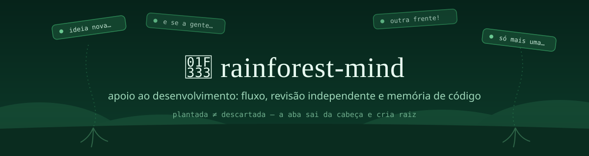
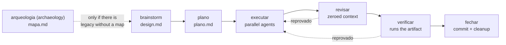

<p align="center">
  
</p>

<p align="center">
  
  
  
  
</p>

> **Snapshot** of [README.md](README.md) (Portuguese, canonical) as of v2.5.2 / 2026-11-07. It may lag behind the Portuguese version.

> ### The problem is not a lack of ideas. It is what gets the light right now.

A Claude Code plugin for **development support**: the feature leaves a
conversation and arrives in a merged PR by a path you can **read and decide on**.
Four things, and none depends on you remembering to switch it on:

- **a seven-stage flow** — `brainstorm` (brainstorming) → `plano` (plan) → `executar` (execute) → `revisar` (review) → `verificar` (verify) → `fechar` (close) — in which the next stage does not open unless the previous one is closed;
- **independent review with a verdict** — a reviewer with a zeroed context reads the real diff, not the account of whoever implemented it, and ends in `VEREDITO: ok` or `reprovado`;
- **it calls nothing done** without pasting the output that proves it;
- **code memory** — what earlier sessions learned in the repository comes back by the subject of the request, in the session and in the subagent briefing.

The first three have a lock that runs **outside the model** — a command with an exit
code, not an instruction. You cannot argue with them.

The declared focus, the scope radar, the workday guardrail and the multi-window
radar are still here, off by default since 2.0:
[Focus and working memory (optional)](#foco-e-memória-de-trabalho-opcional).

## Installation

```
claude plugin marketplace add luisfmontes/rainforest-mind
claude plugin install rainforest-mind@rainforest-mind
```

Or point `--plugin-dir` at the folder of the repo under development.

What changed in each version: [Releases](https://github.com/luisfmontes/rainforest-mind/releases), published automatically by `.github/workflows/release.yml` when the bump reaches `main`, and the [`CHANGELOG.md`](CHANGELOG.md).

**One requirement: Node on the PATH.** Nothing else. Details on the runtime, the
Python twins and the context budget in [`docs/runtime-e-orcamento.md`](docs/runtime-e-orcamento.md).

**Claude Code 2.1, patch 287 onward, for the full opening.** In that version the plugin delivers
the rules and their elaborations as a section of the system prompt (`hooks/register.ts`). Without
it, or in Codex, the opening comes through the hook with the core, as before. The same version draws
the session bar above the prompt (`hooks/mod.tsx`): state, tokens, cost, context, cache,
subagents, errors and, with focus on, the ⏰ clock for the workday warnings (rule 8) and the stalled-window warnings (rule 17), plus the
`/painel` command (in the "Deixado para depois" ("Left for later") board, each item has "Faz agora" ("Do it now") and "Vira pendência de <fluxo>" ("Becomes a pending item of <flow>"), which only fill in the prompt: you are the one who sends), the PR panel (`/pr`), which opens by itself on every `gh pr` and wakes Claude up
when the session's PR turns green, red, conflicted or merged, and `/plugins-em-dia`, which
keeps plugins up to date without leaving the session and warns (or reloads) the other open windows. **The panel requires Claude Code 2.1, patch 292 onward**, the version in which it was measured,
in the terminal, on both accounts; on desktop the layout was not measured. Without the mod, there is no bar, panel
or clock warning, and nothing else changes. Part of the panel is adapted from terminal-desk (MIT);
credit in [`NOTICE`](NOTICE).

You do not need to configure anything to start: the flow, the locks and the memory come
switched on. Focus is optional — [how to switch it on](#foco-e-memória-de-trabalho-opcional).

## How it looks in practice

You ask for a feature. Instead of going off to code, a numbered round arrives,
each question **already with the recommended answer**:

> ❓ **Q1 — Where the token lives**: server-side session or JWT on the client?
> ➡️ **I recommend:** server-side session — you already have Redis, and revoking a JWT requires a blacklist, which is the same work with more moving parts.
>
> ❓ **Q2 — Expiry**: 15 min with refresh, or a fixed 8h?
> ➡️ **I recommend:** a fixed 8h — refresh only pays off with multiple devices, and that is not your case today.

And then it **stops and waits**. You answer `1 ok, 2 no, use 15 min` — three
words instead of composing everything from scratch.

The rule behind this: **finding out a fact is the assistant's job, never
yours.** What is in the file, which version is installed, what the log says — becomes
a search it runs, not a question to you.

And the add-on at the end of the request does not silently become scope:

> **You:** do option 2. Oh, and we could put a cache on that.
>
> **Without the plugin:** *"Great idea! I'll implement option 2 with a cache…"*
>
> **With the plugin:** *"Settled: option 2. You added the cache — does it enter the scope now, or shall I plant it?"*

With the design approved, the plan becomes tasks with a falsifiable criterion, and each
task goes to an agent in an isolated worktree. Whoever approves the delivery is not
whoever wrote it: the reviewer receives the diff, opens each finding with its severity and
closes with the verdict, and the hook hands the turn back when the two do not match:

> **[media]** `hooks/x.cjs:42` — an unreadable config brings down the opening instead of falling back to the default.
>
> VEREDITO: reprovado

The critique goes back to the executor, the next round compares the findings with those of the
previous one, and only `revisar ok` opens `verificar`, which runs the criterion of each
task against the real artifact. On the next request about the same subject, up to
three memories from the sessions that already touched that area enter the context on their own
([Memory by subject](#memória-pelo-assunto-três-canais)).

## The flow: seven stages you cannot skip



Each stage is a skill that can be invoked on its own — you can enter in the middle, which is the
normal case for whoever resumes work.

**What makes this a flow and not advice:** each stage opens by running
`estado.cjs exigir`, and that command **exits with code 2** when the previous one
has not closed.

```
$ node scripts/estado.cjs exigir --slug 2026-08-11-exemplo --estagio revisar
RECUSADO: 'revisar' exige executar fechado(s).
  executar: status=parcial
Rode o estagio 'executar' antes.
```

`parcial` and `reprovado` **do not close**: "5 of 7 tasks" stops turning into "done"
without anyone deciding that.

**Resuming is a command, not memory.** A new session runs `estado.cjs proximo --slug
<slug>` and knows where it stopped. Design, plan and flow state are versioned on
purpose — that is how another dev picks up the task in the middle. An `executar` that is
halfway done is resumed with `estado.cjs retomar --slug <slug>`, which reads the
`Rainforest-Tarefa` trailer of the commits and says what to re-mark, what to redispatch and which
layer comes now.

## The session title says whether the flow closed

On `/exit`, the `SessionEnd` hook `hooks/titulo-sessao-end.cjs` prefixes the
session title with the state of the flows it touched: `[ok]` when all of them
closed, `[aberto: <estágio>]` when one was left halfway.

The `/resume` search matches against the `customTitle`: typing the word `aberto`
filters exactly the sessions that were left halfway — that is why the
marker is a word, not a symbol.

The hook stays **silent** in three cases: a `reason` other than
`prompt_input_exit` (closing the terminal by hand fires no hook at all;
`claude -p` emits `other`), a session with no flow stamped, and a repository
that does not use the flow. A name given with `/rename` takes precedence — the hook only
prefixes, never replaces.

## It does not call anything done without the output

This is the one that pays off most. An agent reports **intent**, not result — and the report is
convincing exactly when it is wrong. Three measured scenes, all with a green suite
and a full success report:

- **The hash that did not exist.** An agent reported the commit it had created: `a009b5b4e8f0d83e3ef4e3d8e7f3e4d8e7f3e4d8`. Look at the end of the string — `e7f3e4d8` appears twice in a row. It is an invented hash, and you could see it without querying anything.
- **The criterion loosened instead of met.** Another met every number in the briefing, honestly — `40 passed`, `exit 0` on lint — **by switching off the two lint rules that were failing**. The `exit 0` was true. *A numeric criterion does not catch whoever edits the ruler.*
- **The protection that never runs.** Code that looks like it protects, behind a condition that the real caller never triggers. The test calls the function directly and passes; production never enters there. No reading of the code caught it — it only showed up **by running the artifact**.

What separated the flawless delivery from the delivery with a bug, measured over three sessions,
was not the model nor the isolation:

> It was whether the briefing contained, or not, **the test that would falsify the delivery** — with
> the exact command and the exact expected output.

**A green suite is not evidence. ✅ without the command and output pasted is not verification
— and the pasted output has to be of the object the claim is about.**

## Mechanical locks

A written rule does not reach the failure mode in which the agent **read the rule and got it wrong
anyway**.

> As long as the verdict of a check is written by the same agent it was
> supposed to stop, it stops nothing. **An exit code cannot be argued with.**

The gate batteries run on Windows + Git Bash (the CI environment: `runs-on: windows-latest`); Linux and macOS are not measured. Each gate declares its threat model in its docblocks.

| Hook (`PreToolUse`, exit 2) | Blocks |
|---|---|
| `gate-worktree.cjs` | a subagent write outside a linked worktree; a subagent Bash/PowerShell in a worktree that cites a main-checkout path outside a read command (the block names the path or the word that blocked it; a redirection target, or the target of `touch`/`cp`/`mv`/`tee`/`mkdir`/`rm`/`ln`/`install`/`sed -i`/`dd of=`, that **starts** with a variable or substitution blocks without the gate judging the value, and the message tells you to write the literal path or use Write; `cd -` with indirect execution blocks and the message names the cause that is on the line and tells you to replace it with the absolute path, also when the one blocking is the git layer); `git checkout/switch/reset` with another session in the same directory |
| `gate-staging-total.cjs` | `git add` with a total path (`-A`, `.`, `*`…) and `git commit -a` |
| `gate-publicacao-destino.cjs` | writing sensitive data (JID, phone number, e-mail, credential) to a tracked file |
| `gate-repo-alheio.cjs` | a write whose destination is inside **another** git repository |
| `gate-fechar-issue.cjs` | a direct `gh issue close`; `closes #N` in a PR without a marked evidence comment; and `gh pr merge --auto`, which without a required check merges immediately without waiting for the CI (toggle `gate-merge-auto`; the wait is `publicar-branch.cjs esperar-ci`). A heredoc body is **data**, not command structure: `cat > x.md <<'EOF'` with prose (`(x). Ele sobe.`, `$(x)`, backtick) passes; the body becomes a command when the heredoc line has an interpreter (`bash <<EOF`, `cat <<EOF \| bash`, `(sh) <<EOF`, `eval`, `source`, `pwsh`…), and its text is always scanned by the direct patterns (a literal `gh issue close 12` in the body blocks, as before). The evidence lookup uses the repo of the citation itself (`owner/repo#N` or the Issue URL), otherwise the one from the command's `-R`/`--repo`, otherwise the one from the command's directory; in `gh pr merge <URL>`, the one from the URL. If the Issue cannot be read, it blocks with `não consegui ler a Issue #n`, a message of its own, which does not tell you to comment evidence |
| `gate-mensagem-commit.cjs` | `git commit` with a subject over 72 columns or ending in a period; without a body when the stage goes beyond 3 files or 150 lines; and a message the hook cannot read (`-F -`, heredoc, a bare `git commit` — closing a merge, `-F .git/MERGE_MSG`) |
| `gate-verificador-staged.cjs` | `git commit` whose **staged** content the repository's verifier rejects — discovered in this order: the `"verificador-staged"` key in `.rainforest/config.json`; otherwise `scripts/check-personal-data.py|.cjs|.sh|.js`; otherwise `scripts/conferir-publicacao.cjs`. It materializes the blobs (`git show :<path>`) in a temporary folder and calls the verifier with those paths; its output goes to stderr. A repo without a verifier passes |
| `gate-subagente-sem-gh.cjs` | inside a subagent, a `gh` that writes to GitHub (`issue close/comment/edit/create…`, `pr create/merge/comment…`, `release`, `gist`, `alias set`, `extension install`, `workflow run`, `run rerun`, a family that is not `gh`'s own — alias or extension —, `api` with a method ≠ GET or with a field) — in the command, behind a wrapper, in `bash -c` (unreadable also denies), in a heredoc and **inside the script being executed**, which is read before it runs (`bash`/`sh`/`source`/`python3`/`node`/`pwsh`, `./x.sh`, `./x.ps1`, `bash < x.sh`, `cat x.sh \| bash`), and the inline code of `node -e`, `python -c`, `pwsh -Command` and `cmd /c`. It exempts only a `testa-*` battery tracked by git; `scripts/fechar-issue.cjs` is denied by name. The main window always passes. Toggle `subagente-sem-gh` |
| `gate-subagente-sem-instalar.cjs` | inside a subagent, package installation (`npm/pnpm/yarn/bun/pip/pipx/poetry/uv/cargo/go/gem/brew/apt/choco/scoop/winget`, `python -m pip`, `npx -y`, `Install-Module`…) — also behind `bash -c`, `sudo`, `env`, `FOO=1` and in PowerShell, decided by the subcommand (`npm test`, `yarn build` pass) —, and defining `RAINFOREST_GATE_OFF` — the key that switches a gate off does not belong to the subagent. It does not honor its own emergency exits. Toggle `subagente-sem-instalar` |
| `gate-matar-por-nome.cjs` | killing a process by name, in the subagent and in the window (`taskkill /IM` and `/FI IMAGENAME`, `pkill`, `killall`, `Stop-Process -Name`, `Get-Process <name> \| Stop-Process`, `kill` fed by `pgrep`/`pidof`) — also behind `bash -c`, `sudo`, `env`, `FOO=1` and `pwsh -Command`; by PID passes (`taskkill /PID`, `kill <pid>`, `Stop-Process -Id`), and the message teaches how to list and kill by PID; `RAINFOREST_GATE_OFF` applies only in the window, never to the subagent; by port is out of scope. Toggle `matar-por-nome` |
| `portaria.cjs` | dispatching a subagent not declared in `.rainforest/agentes.json`, or without `isolation: "worktree"` when it writes (with the cwd outside a git repo, where the harness does not create a worktree, the line `Worktree: <absolute path>` in the briefing applies instead, checked as a linked worktree, #565); an agent that writes (`escreve: true`) outside its `estagios`, without `leve` on the branch, in a repo with a flow; also every dispatch with `isolation: "worktree"` (declared or not, `general-purpose` included) and every agent outside the manifest that writes (a write tool in the frontmatter, or a frontmatter without a `tools:` line, which inherits all of them), when the session's branch has no open stage and no `leve`. Without `isolation` and with the agent's file unreadable, the dispatch passes (what catches the write is the `gate-worktree`); an agent with a frontmatter without `tools:` is only exempt from `isolation` in a repository without a flow track (with a track, rule 11 blocks it like any writer), and dispatched with a `name` it is blocked in any repository |
| `gate-teto-despachos.cjs` (`PreToolUse` on `Task`/`Agent`) | dispatching an agent of the active flow above the ceiling: by default `max(40, 1.5 × plan tasks)`, a cumulative count over the whole flow, or the one declared in the plan's `teto-despachos: N` header, plus +10 for each `estado.cjs liberar-teto --motivo "..."`. The counter lives outside the repo (`<dados>/fluxos/<slug>/despachos.json`); outside a flow it does not count. No toggle and no escape variable: the way out is `liberar-teto` |
| `aviso-fluxo.cjs` (`PreToolUse` on Edit/Write/MultiEdit) | editing a code file outside `docs/` with no open flow and no `leve` on the branch, on the rainforest and protheus tracks. A file ignored by git passes, because it does not reach the history (#623). The message gives the two ways out: open the flow (`/rainforest-mind:brainstorm`, or `/protheus:trabalhar`) or `node <plugin>/scripts/estado.cjs leve --motivo "..."`. The `aviso-fluxo` config key switches it off |

`aviso-fluxo-shell.cjs` (`PostToolUse` on Bash/PowerShell, #564) warns without undoing: the command has already run, and the exit 2
brings the model the warning that it left a new code file in `git status` (outside `docs/`) with no flow
open and no `leve` on the branch, with the same ways out as `aviso-fluxo.cjs`. It decides by `git status` and by the
commits the session itself made (the `commit` entries of the reflog), not by how the command is spelled; `pull`, `merge`,
`rebase` and a conflict in progress do not warn, and each path warns once per session. The `aviso-fluxo` key switches off both.

`aviso-duplicata.cjs` (`PostToolUse` on Write/Edit/MultiEdit) warns without blocking (exit 0 with `additionalContext`):
it extracts from the written text the top-level definition names (JS/TS, Python, Dart and `User Function`/`Static Function`/`Class`
of ADVPL/TLPP, case-insensitive) and, when the same name is already defined in another tracked file, says
"`x` já está definido em `caminho:linha`" ("`x` is already defined at `path:line`"), at most three names. The name only goes to `git grep` (no shell, with
`--`) after matching as an identifier; 3 s budget and fail-open. In Protheus, a repeated `User Function`
collides in the RPO. The `aviso-duplicata` key switches it off.

One hook warns without blocking (exit 0 with `additionalContext`): `idioma-session-start.cjs`
(`SessionStart` on compaction) re-injects the language from the config's `idioma` key,
which slipped after compaction.

Outside the table because the mechanism is different (`Stop`, exit 0 with
`{"decision":"block"}`, and **opt-in** through the `gate-review-codex` key):
`gate-review-codex.cjs` blocks ending the turn without the `revisor` in Codex saying
`ALLOW` about the last answer; Codex unavailable, an unrecognizable answer
or a transcript the hook cannot read block with a reason (fail
closed). Only the key switched off and the next turn's `stop_hook_active`
release without asking. Codex out of quota blocks saying so, with the time of
return (the dispatch exits 75 and writes `codex sem cota: ...`).

Outside the table, same mechanism (`Stop`, exit 2 with a message and **on by default**,
switchable off by the `gate-turno-prometido` key in `.rainforest/config.json`):
`gate-turno-prometido.cjs` blocks the turn that promised a future or in-progress
dispatch (phrases from the design such as "vou despachar" ("I will dispatch"), "despachando" ("dispatching")) and the turn
has no `tool_use` of `Agent`, `Task`, `SendMessage` or `Workflow`; it also blocks a turn
that says it is waiting on a machine ("CI rodando" ("CI running"), "aguardando build" ("waiting for build")) and has no `Bash`
or `PowerShell` with `run_in_background === true`, `Monitor`, or `ScheduleWakeup`. Past tense
("despachei" ("I dispatched")) and negation ("não vou despachar" ("I will not dispatch")) do not trigger it. A promise with immediate execution passes; `stop_hook_active === true` releases. A subagent (payload with `agent_id`) is not checked. An unreadable payload or transcript exits 0 with a warning on stderr. It also blocks, once, the turn that ends by asking permission to proceed ("Sigo com o executar?" ("Shall I proceed with the executar?"), "posso seguir?" ("may I proceed?"), "quer que eu siga" ("do you want me to proceed")) with no `Q<n>` at all, when the branch has a flow with an approved design and `fechar` open and the `executar-autonomo` key is on in the project. A closing in bold, an emoji or a parenthesis does not hide the request. These pass: a turn with a `Q<n>`, a question in the middle of the text and a question in prose outside that pattern ("Devo seguir…?" ("Should I proceed…?")).

`gate-pergunta-memoria.cjs` (`Stop`, on by default, `gate-pergunta-memoria` key) blocks once the turn that raises a `Q<n>` (at the start of the line, up to the first `?`; an emoji, bold, a `#` heading, a numbered item `1.`/`1)` of up to two digits (a year such as `2026.` does not count) and the bullets `-`, `•` and `+` are allowed before it) whose text shares at least three terms with the name or description of a file in the project's memory, not counting the project's own vocabulary (`regra`, `fluxo`, `worktree`, `agente`, `plano`…), and it cites the `Q`, the file and the description. The memory is that of the **main** repository (the same one Claude Code loads, also in a session opened in a worktree), in the session's accounts folder. Only the memory files count. The `memoria.cjs` observation database is not consulted: measured on 2026-10-29, the 11 distinct blocks it produced were all false positives, because one shared rare term (a routine's code, a customer's name) was enough to match a session summary that did not answer the question. In the same message it lists the live sessions of other repositories, to ask them before asking you. A question in prose without `Q<n>`, a `Q<n>` in the middle of a line (recap) and a `Q<n>` without `?` are not checked; the gate does not distinguish a code block, so a `Q<n>` at the start of a line inside a fence is checked like any other; a missing payload, transcript or memory exits 0.

They apply in **any** git repo on the machine, because the habit is the problem,
not the repository. Each one has its own battery — **849 cases** running the real hook
against git repos assembled on the spot (sum re-measured on 2026-09-14, with the heredoc cases and the quoted staging:
201 + 106 + 24 + 27 + 151 + 25 + 307 + 8 — the portaria now sums the **ten** `testa-portaria-*.cjs`, which `varrer-baterias.sh` has run directly since 1.24, 92 + 14 + 24 + 10 + 28 + 8 + 16 + 87 + 5 + 23 (the `portoes` counts 5 because it prints gates, not cases); to re-verify: the last line of the `hooks/testa-<hook>.sh` battery of each row in the table).

→ The origin incident of each lock, the emergency exits and the table of
scripts with exit codes: [`docs/travas-mecanicas.md`](docs/travas-mecanicas.md)

| Script | Validation |
|---|---|
| `scripts/estado.cjs iniciar` | Refuses (exit 2) to open a flow in the **main checkout outside the default branch** — the repository folder stays on `main`, work is born in a worktree (rule 11, Issue #195). The message brings the recipe (`git worktree add …`, `git checkout main`); `exigir` in the same state only warns. A clone dedicated to one front declares `"principal-livre": true` in `.rainforest/config.json`; in CI (`CI`/`GITHUB_ACTIONS`) it does not apply |
| `scripts/publicar-branch.cjs` | Step 5 of `fechar`. `publicar`: `merge-tree` against the base before the push (conflict **exit 3**, no push; a `merge-tree` that fails **exit 69**, never read as clean), push and `HEAD == @{u}` (**exit 4**), and `PR aberto: <n>` or `nenhum`, without creating a PR. `esperar-ci --pr <n>`: with a PR workflow in the checkout, waits up to 300 s (`RFM_CI_PRAZO_REGISTRO_S`) for GitHub to register the CI of the newly created PR, then `gh pr checks --watch`; red **exit 5**; a CI that could not be verified (network, or a wait interrupted with checks still pending) **exit 69**, with `nao-verificavel:` on stderr; green with the `fechar-mergear` key off (default) **exit 7**; no workflow of the checkout reaches a PR (cites `pull_request`, or `push` without a `branches` filter) and the PR has no check **exit 8** (the evidence is `verificar`, and the line says whether the merge is authorized). `confirmar-merge --pr <n>`: only the `MERGED` state exits 0, otherwise **exit 6**. It never runs `gh pr create` or `gh pr merge`: those go through `gate-fechar-issue` |
| `scripts/recibo.cjs` | Freezes the deliverable's identity with sha256 + bytes; called by `fechar` when the plan declares `entregaveis` (opt-in, without a manifest it exits 0). It requires a listed `nao_provado` — a receipt that claims to prove everything is suspect. It re-runs gates with `--reverificar` if `docs/rainforest/portoes/<slug>.md` exists. It writes atomically to `.rainforest/colheita/<slug>-recibo.json` (outside git). `mostrar <slug>` prints; `conferir <slug>` recomputes the hash and compares. |
| `scripts/conferir-duplicacao.cjs` | Two byte-for-byte identical files outside `fixtures/`, `node_modules/`, `.git/` and `.claude/worktrees/` → **exit 2** with both paths on the same line; `--funcoes` inventories repeated names among `scripts/*.cjs` (exit 0, it is an inventory). Called by `conferir-publicacao.cjs --commit` and by `/saude` |
| `scripts/conferir-publicacao.cjs --commit <rev>` or `a..b` | Scans the **committed** content, not the disk: sensitive data that has left the file but stayed in the history is a finding; disk ≠ commit becomes `diverge-do-commit`. Exit 2 finding, **69** when the environment prevents it |
| `scripts/conferir-glossario.cjs` | Checks the `GLOSSARIO.md` at the repo root and rejects an entry with a required field missing (Definição, Onde mora, Cenário), a duplicate term or a line injected above 900 B: **exit 1**, each defect named as `GLOSSARIO.md:<line>`. `--exigir` makes the file's absence a defect; `--caminhos` checks paths in backticks. The CI runs it with `--exigir --caminhos` (`.github/workflows/baterias.yml`) |
| `scripts/conferir-ancoras.cjs <mapa.md> [--repo <raiz>]` | Checks the `arquivo:linha`, `arquivo:N-M` and `arquivo#Simbolo` anchors of an archaeology map: the file exists, the line fits in it and the symbol appears where the map says. One line per anchor (`ok`, `arquivo-ausente`, `linha-fora`, `simbolo-ausente`, `ambiguo`, `fora-da-raiz`): **exit 1** on any failure, **2** usage. It also reads the `## Regras implícitas`: each `**R<n> — título**` with `Verificada em:` and `Teste:` comes out `testada` (the `Teste:` file exists under the root and cites `R<n>`), `teste-ausente`, `teste-sem-id` or `sem-teste` (warnings; `Teste: nenhum` is the last) or `sem-campos` (**exit 1**); `Verificada em:` with a sha that does not resolve in the mapped repo gets the line `sha-desconhecido` (warning); a rule in the old format, without an id, comes out `sem-id` as a warning. The `arqueologia` runs before re-reading the `CONFIRMADO` ones |
| `scripts/baterias-do-diff.cjs --base <ref> [--head <ref>] [--raiz <dir>]` | The `testa-*` batteries affected by the diff: the altered battery and every battery that cites the base name of an altered file (the D25 reading of `conferir-entrega`, in `scripts/lib/baterias-vizinhas.cjs`). One per line, **exit 0**. A file that no battery cites, or a shared library (`hooks/lib/`, `scripts/lib/`), ends with `rodar tudo: <arquivo> — <motivo>` and **exit 3**: doubt never narrows the selection. `.md` and files under `docs/` raise no doubt, but list the battery that cites them. `verificar` and `executar` use it to choose the local batteries |
| `scripts/co-mudanca.cjs <arquivo> [--meses 6] [--min 3]` | Files that changed together with the target in the history: at least `--min` commits together and score `together / target's changes` ≥ 0.3, from highest to lowest; a commit with more than 20 files does not count. A target with little change says "histórico insuficiente" (insufficient history) (exit 0). The `arqueologia` runs it per file of the slice, and the `plano` checks `arquivos:` against it |
| `scripts/conferir-fluxo.cjs camadas --slug <slug>` | Layers of `executar` computed from the plan's `depende de:` (Kahn), in JSON. **Exit 2** with a cycle, a `depende de:` citing a nonexistent task, or two tasks in the same layer with `arquivos:` in common; `paralela:` is no longer required and, in an old plan, only warns. The `acoplamentos` field lists pairs in the same layer where a file of one task does a `require`/`import` of a file of the other, and the `cobertura` warns about each one on stderr, without changing the exit |
| `scripts/estado.cjs retomar --slug <slug>` | State per task (`integrada`, `em_voo`, `pendente`). A task is `integrada` only with a commit `Rainforest-Tarefa: <slug>#<n>` on the branch, never by the JSON. It returns `re_marcar`, `redespachar`, `contadas_sem_trailer` (counted in the JSON without a commit) and `proxima_camada`; the `marcar` of executar accepts `integradas: [n]` |
| `scripts/painel-fluxo.cjs gerar --slug <slug>` | Local HTML panel of the flow at `<dados>/fluxos/<slug>/painel.html`: a card per task (state, layer, loop iteration) and a summary (in flight, remaining, stage, verdict, stopped). The `marcar` of executar, revisar and verificar regenerates it; a failure becomes a warning and does not change the exit |
| `scripts/integrar-tarefa.cjs --slug <s> --tarefa <n> --worktree <w> --base <h> --head-antes <h0> --sujo-antes <f> --titulo <t> [--repo-principal <dir>]` | Integrates a task of `executar` in a single command, in this order: `conferir-entrega` with the task's `arquivos:`, `git apply --index` of the agent's `base..HEAD` diff (all commits, atomic; an index with a prior stage is refused), the task's mutation (`conferir-fluxo.cjs mutacoes --tarefa <n>`), a commit with the `Rainforest-Tarefa` trailer, `marcar` with `integradas` and removal of the agent's worktree. **Exit 0** accepted; **exit 2** refused, with the step in the JSON and the branch as it was; **exit 69** environment. Running again after a 69 in `marcar` resumes without a new commit |
| `scripts/rodar-longo.cjs iniciar --saida <arq> -- <cmd>` / `estado --saida <arq>` | Runs a battery or mutation outside Bash's 10 min ceiling. `iniciar` starts a detached watcher and returns immediately. `estado` prints `rodando` (**exit 3**), `exit <N>` (**exit 0**, read from `<arq>.exit`) or `morto` (**exit 4**, the watcher vanished without registering) |
| `scripts/estado.cjs pendencia --slug <s> --texto <t>` | Appends `<t>` to the `pendentes` of the open stage (what `proximo` returns) without changing the status; repeated text does not duplicate, empty text exits 1, a complete flow exits 2. From then on the rule of #449 applies: the stage only closes `ok` with a destination for it. It is the command that the **Vira pendência de <fluxo>** button of the "Deixado para depois" board puts in the prompt (#470) |
| `scripts/estado.cjs decidir --slug <s> --pergunta <p> --escolha <e> --porque <m>` / `decididos --slug <s>` | Autonomous mode (`executar-autonomo` key, default off): a decision that arises between `plano ok` and the merge goes to `decididos` instead of becoming a question. `decididos` prints the `## Decidido sem você` section of the PR body. Without `--porque`, **exit 2** |
| `scripts/estado.cjs reabrir --slug <s> --estagio executar --motivo <m>` | Reopens `executar` after `revisar`, `verificar` or `fechar` are closed: `executar` becomes `parcial`, the next three `pendente`, and `reaberturas` gains `{em, de, motivo}`. **Exit 2** with an empty reason, a stage that is not `executar` or nothing to reopen; a slug without state exits 1 (#529) |
| `scripts/estado.cjs exigir --estagio fechar` | Besides `verificar ok` and destinations, refuses (**exit 2**) when the code changed after `verificar ok`: a file with content different from the verified one in which the branch's change is no longer the same (`git patch-id --verbatim` without context of `merge-base..head` before and after; a clean merge of `main` and a squash do not count), or a dirty tracked file, outside the exemptions of `creep` and of any slug's state. It names the files and tells you to `reabrir`. Without `verificar.head` (old state or `verificar` with `--raiz`), it only warns. The same refusal runs in `marcar fechar ok` (without `verificar.head`, it warns) and, against the HEAD of the `revisar` snapshot, in `marcar verificar ok` (skipped with `--raiz`) (#567) |
| `scripts/estado.cjs marcar --json {"carimbos":…}` | Records per task the base hash on which it was accepted (`iteracao` grows, nothing is erased); refuses a hash that is not a commit of the repository; `proximo` and `ler` warn when that hash is not an ancestor of HEAD |
| `scripts/estado.cjs marcar --estagio executar --status ok` | Runs the plan's `cobertura`, like `plano ok`: an amendment made during executar that leaves a block unreadable (a note between `para:` and `bateria:` of a `mutacao:`, for example) refuses the `ok` with **exit 2**. An amendment after `executar ok` falls under the post-verificar reopening |
| `scripts/testa-teto-skills.sh` | No `SKILL.md` above 500 lines or 16,384 B — the failure says what to move to `references/` |
| `scripts/testa-mapa-regras.sh` | Each of the 17 rules has a row in `## Regra → trava` of `docs/travas-mecanicas.md` (an existing hook/script **or** `disciplina`), and every cited file exists |
| `scripts/conferir-fluxo.cjs mutacoes --slug <slug> [--plano <arquivo>] [--tarefa <n>] [--gravar-flake]` | Runs the ratchet for each plan task that declares `mutacao:` (`conferir-mutacao.cjs` with the literal fields of the block) and prints one line per task: `vermelho`, `mutante sobreviveu` or `pulada (<motivo>)`. Tasks with the same battery, `raiz:` and `timeout:` measure the baseline only once (`--baseline-para`/`--baseline-de`), except `no-lugar: sim`; the copy is of the whole repository, and the battery runs in the `raiz:` folder. The ratchet reads the battery's score in the forms `ok: N falhou: M`, `N ok, M falha(s)` (and `falhas`, `falha`, `falhou`, any case), `ok=N falhou=M`, `test result: ... N passed; M failed` from `cargo test` and `Tests  N failed | M passed (T)` from vitest (read per segment: `Tests  1 failed (1)` also counts; `Test Files` does not); with the score read, a post-mutation that dies before printing it is a collapse (exit 6). **Exit 1** if any mutant survived, 0 if none (or everything skipped), 2 if the plan does not exist; `--plano` points to the file when it is not at `docs/rainforest/planos/<slug>.md` — it is what `marcar verificar ok` passes (Issue #192); `--tarefa` measures only one task; `--gravar-flake` (only the integration passes it) forwards `--slug`, `--tarefa` and `--raiz-estado` to the ratchet, which records in the flow's state the green battery only on the new attempt (#498); a task with `no-lugar: sim` in the block passes `--no-lugar` to the ratchet, which measures in the real tree without a copy and restores the file byte for byte, for a battery tied to a live process such as the open Unity editor (#527) |
| `scripts/eval-gatilho.sh trava|mutacao <skill>|baseline` | Trigger eval of the skills (Issue #302), **on demand and outside the CI** — each round is paid (~US$ 0.32 per case). `trava` runs each case in `evals/` 3 times with `--ablation none` (the skill firing counts in the score) and approves by majority; `mutacao` sabotages the skill's `description` in a copy and requires the lock to go red; `baseline` runs `with-without` once for the "adds / dead weight". `scripts/testa-eval-gatilho.sh` proves the mechanism with a fake `claude`, at no cost |
| `scripts/testa-sandbox-com-trap.sh` | Static guard for the `testa-*.sh` batteries that create a sandbox: **more than one** `mktemp -d` in the file requires the idiom `SANDBOXES=()` + a function that registers each box + a single `trap … EXIT` that sweeps the array; **a single** `mktemp -d` is enough with a simple `trap … EXIT`; a sandbox with no trap at all fails. The guard itself and `testa-dependencias-de-bateria.sh` are left out of the real sweep (their fixtures cite `mktemp -d` as text); `--autoteste` proves the guard with synthetic fixtures (Issue #216) |
| `--confirmo` in `limpar-branches.cjs` and `limpar-worktrees.cjs --remover-sujo` | Deleting a branch and removing a dirty worktree require the literal phrase that the script itself prints (`CONFIRMO apagar branches a,b`), typed by you and passed on verbatim — a phrase for another target exits 2 and nothing happens |
| exit **69** `nao-verificavel:` in `conferir-entrega`, `conferir-mutacao`, `conferir-fluxo`, `conferir-ponte` | The environment prevented the check (worktree vanished, `git` off the PATH, a battery that does not run, a temporary folder not writable, which the ratchet checks before the baseline; a PATH without the Git Bash utilities is not checked beforehand, because the battery already fails visibly with `command not found`): neither approval, nor rejection, nor `flaky` — it announces in one line and does not redispatch (rule 14) |

## Commands, skills and agents

**The flow**

| | |
|---|---|
| `divergir` | **Before** the brainstorm: six isolated frames in parallel plus a blind critic. Returns material, does not decide |
| `arqueologia` | Stage 0, optional: maps the slice of legacy that the demand touches |
| `/brainstorm` | Stage 1: adversarial interview as a decision tree, records the design |
| `plano` | Stage 2: typed tasks, declared dependency, falsifiable criterion; a task that creates new code declares the search in `busca:` (`scripts/conferir-busca.cjs`) |
| `executar` | Stage 3: dispatches agents, each in an isolated worktree |
| `revisar` | Stage 4: zeroed context, scope fixed by the diff — the account is not a source |
| `verificar` | Stage 5: runs the real artifact and pastes the output |
| `fechar` | Stage 6: commit, cleanup, PR as the branch's destination |
| `limpar` (clean up) | Maintenance outside the flow: orphan worktrees and branches |

**Day to day**

| | |
|---|---|
| `/foco` | State of the conversation; `/foco <text>` declares a new focus, which only enters the opening with the [focus on](#foco-e-memória-de-trabalho-opcional) (off, the declaration warns how to switch it on) |
| `/ideia <text>` | Evaluates against the declared focus, with focus on, or against the repository and the open flow, with it off: inside → enters; outside → plants with context |
| `/issue` | Opens an Issue in the repo you are in, with the body written and the evidence pasted |
| `/feedback` | Records what the session taught about the method |
| `/saude` | Only what the official checkers do not know. A shallow clone of the marketplace (`git clone --depth`) never becomes "no kinship": if the clone's commit does not exist here, it is a warning, without `reset --hard`. Config dirs `*bench*` and `*.aposentada` are left out of the checks by default; the `saude-ignorar-config-dirs` key replaces that list, and `[]` compares all of them |
| `/setup` | The first time, a guided interview: one question at a time, only what is your decision, and it writes everything at the end after showing the diff. Afterwards, it shows the state and changes one part |
| `/semear` | Proposes what to create **in this** repo from what it has already stumbled on |
| `glossario` | Proposes, migrates or lists entries of the repo's `GLOSSARIO.md`; writes only after approval ([skill](skills/glossario/SKILL.md)) |
| `/vigiar <contact>` | Follows a WhatsApp conversation without spending tokens and wakes the session when the person writes. Requires the `integracao-whatsapp-mcp` integration on and the account's bridge up; the flow lives in the [whatsapp-mcp](https://github.com/luisfmontes/whatsapp-mcp) repo |
| `/regua` | A named external ruler, builder against a blind critic — for what has no test. Phase 0 distills the ruler into 5-7 mechanisms checkable by eye in `docs/rainforest/reguas/<slug>.md` (the builder does not see them; the critic does) and does the rendering preflight, naming which critic would be blind. The ruler is **sealed by the commit that added it**: `scripts/conferir-regua.cjs` (`validar` before sealing, `conferir`, `mostrar`) refuses a ruler altered afterwards, and `mostrar` is the only path that prints it. From the 2nd round on, a second blind critic compares the new one with the best kept and decides **keep/discard** by itself; the rounds stay in a versioned TSV |
| `/transferir` | Takes the current session to Codex. Without an argument: a Codex thread resumable by `codex resume <id>`, requires `transfer-codex` on in `/setup`. `/transferir claude` was withdrawn: it exits 2 and points to `/conta` |
| `/conta` | Without an argument: the account in use in each folder and the usage of both accounts. `/conta pessoal` or `/conta trabalho`: switches the session's folder by hand (`--pasta` chooses the other one) (with no automatic return until the next manual switch). `/conta preparar pessoal\|trabalho`: prepares the reserve login. `/conta unificar [--aplicar] [--profile <arquivo>]`: merges the personal folder into the work one, with a report before writing ([step by step](#juntar-as-duas-pastas-numa-só)). It refuses with Claude open, even for the report: run it in a terminal without Claude open. It is the way to switch a folder's account, in place of the old `/transferir claude`. Details in the section [Automatic account switching](#troca-automática-de-conta) |
| `/ponte` | Generates `CLAUDE.md`, `AGENTS.md` or `GEMINI.md` ([details](docs/pontes.md)) |
| `modo-dev` | YAGNI ladder, root cause before patch, diff traceability |
| `depurar` | Builds the feedback loop **before** any hypothesis |
| `enxugar` | Lists (never applies) dead code, bloat and unused abstraction, in a diff or in the whole repo. In the whole repo it opens with the largest files and the most complex functions (`catalogo-funcoes.cjs complexas`: cognitive and cyclomatic complexity per JS/TS and Dart function, with the three contributions that weigh most; an approximate measure, by reading text) and runs the **semantic duplicate** pass — a function with a different name and the same intent: `scripts/catalogo-funcoes.cjs` catalogs the functions (JS/TS, Dart, Python, ADVPL), a haiku agent groups by domain, one sonnet per group compares, and the catalog checks every `arquivo:linha` before it becomes a `duplicar:` finding |
| `analisar` | Notebook analysis: one question at a time, critical review of the finding |

**Agents by function** — the main window thinks; the agent executes.

| | |
|---|---|
| `executor` · `resolvedor-de-build` · `documentador` | haiku, mechanical task |
| `planejador` · `revisor` · `tester` · `depurador` | sonnet, task that requires judgment |
| `arqueologo` · `auditor-de-seguranca` | sonnet, run their own skill |

The `revisor` opens each finding with the severity, `[alta]`, `[media]` or `[baixa]` (and `[design]` when it contests a decision), and ends with `VEREDITO: ok` or `VEREDITO: reprovado`. The verdict hook hands the turn back when the two do not match: `ok` with `[alta]`, or `reprovado` without a marked finding. Each `exigir revisar` keeps the previous round in `revisar.voltas`, and `critica-do-revisor --comparacao` compares the findings with those of that round by file: `novo`, `persiste (mesmo arquivo)` or `sumiu — confirmar se foi corrigido`. That block goes in the briefing of the next round's reviewer; the default output of `critica-do-revisor` is the critique that goes to the loop's executor. A finding that was already in the diff's base carries `[preexistente]` next to the severity and does not count toward the block; the mark is refused when the cited line is in a stretch the diff altered, and accepted preexisting ones leave the executor's critique. The `executor` dispatched inside a flow ends its report with `ENTREGA: completa` or `ENTREGA: parcial`; without the line, the `relato-executor` hook hands the turn back once (key `contrato-relato-executor`).

The `auditor-de-seguranca` runs two OWASP rulers (Top 10 2025 + API Security 2023) and a **Ruler 3 of techniques** — [`referencias/reguas-tecnicas-ofensivas.md`](referencias/reguas-tecnicas-ofensivas.md), 30 defensive-detection lenses derived from the `SnailSploit/claude-red` repository (MIT) and rewritten report-only — which sharpens the other two to the level of attack technique. When the inventory finds personal data, it also runs **Ruler 4 — LGPD**: nine categories visible in the code (personal data in logs, collection beyond what is necessary, missing data-subject rights, incomplete deletion, retention without a deadline, sending to a third party, unprotected sensitive data, badly collected consent, minors), each finding citing the article of a fixed normative table in the agent itself — never from memory. A legal document (ROPA, RIPD, policy) is out of scope, and the verdict is technical indication, not a legal opinion.

**Agents in Claude or Codex** — each agent has a `runtime:` in the manifest (absent = `claude`); the first line of the briefing can be `Runtime: codex` or `Runtime: claude` as an override (case-insensitive). When the user says "faz no codex", "roda no codex" ("do it in codex", "run it in codex") or equivalent, the dispatch puts `Runtime: codex` on the first line. Transport via `codex exec` uses a `read-only` or `workspace-write` sandbox according to `escreve`, model by `codex-modelo-<haiku|sonnet|opus>` in `/setup` (default from `~/.codex/config.toml`). The skills `review`, `adversarial-review` and `rescue` of `openai/codex-plugin-cc` did not get a command here because they already exist as a function in this plugin: `revisor`, cross-model second opinion, `depurador`.

<a id="troca-automática-de-conta"></a>
## Automatic account switching

A Claude Code account has a 5 h limit and a weekly limit. When the account of a configuration folder (`~/.claude`, the work one, or `~/.claude-personal`, the personal one) reaches the limit, the sessions of that folder carry on on the other account without restarting, and return by themselves when the limit resets.

- **On the switch:** the folder switches account when it passes 97% in the 5 h window or in the week. The destination only qualifies if it is below 60% (5 h) and 85% (week). The switch works in both directions, and mixing the organization's account with the personal one is allowed.
- **On the return:** the folder goes back to its own account when the limit that blocked it resets, by the reset date the server returns.
- **On a manual switch:** `/conta pessoal` or `/conta trabalho` switches the folder at once. A manual switch does not return by itself: the folder stays on the chosen account until the next manual switch. When its account in use passes 97%, the watcher warns once per overrun (`manual_no_limite`), with the `/conta` that gives the folder back.
- **State follows the login:** if a folder's login belongs to an account other than the one the state says (a `/login` done from outside, or an undo that failed), the watcher, `/conta` and the switch align the state to the login, without moving credentials, and record `reconciliado`. Without the lock, `/conta` only shows the divergence on the folder's line. When the folder comes home this way, its old stored login becomes `estacionado-<pasta>.orfao-<data>.json`, because in place it would block the next switch. If the file is stuck (antivirus, indexer), the next round tries again, and the warning of the repeated failure returns at most once an hour.
- **In the sessions:** every switch and every return appears as a warning in the open sessions and generates a line in `<dados>/contas/eventos.jsonl`.
- **The watcher:** a Windows scheduled task runs every 1 minute (`schtasks`), queries the usage of both accounts and does the switch. Each round takes ~0.7 s and no process stays resident; a lock prevents two rounds at the same time. `node scripts/conta.cjs agendar` creates the task `\ClaudeVigias\troca-de-conta` with `/SC MINUTE /MO 1`, with no end date (`/ED`), and only runs after both reserves exist; `agendar --imprimir` only shows the command, without calling `schtasks`; `desagendar` removes the task.
- **A credential is never in two places:** the switch moves the login, never copies it. Each account has a reserve stored outside the two folders, and before moving, both logins must have at least 30 min of life left on the access token (exception: the login leaving the folder, expired for more than 10 min, waives the guard, because no session uses the folder). The manual switch (`/conta pessoal|trabalho`) follows the same guard and, when it refuses, says which login is short and when to try again. The check is done on the server after the switch; if it does not match, the switch is undone; if even the undo fails, the warning says the switch was left halfway or could not be undone and tells you to check with `/conta`.
- **Prerequisite:** with both folders, automatic switching only turns on after `/conta preparar pessoal` and `/conta preparar trabalho`, one browser login per account. With only one folder, `/conta preparar pessoal` is enough.
- **The limits:** 97% to switch, 60% (5 h) and 85% (week) for the destination, in `<dados>/contas/config.json` (`trocarEm`, `destinoMax5h`, `destinoMaxSemana`; a missing key or one outside 1 to 100 uses the default). `/conta` shows the values in use.

**Two folders or one.** Detection is by the personal folder: if `~/.claude-personal` exists, there are two folders, as described above. If it does not exist, the machine has a single folder (`~/.claude`), and the login switch happens inside it. The retired folder (`.claude-personal.aposentada`) does not count as a personal folder.

**One-folder mode.** The folder's home account is the team one. The folder moves to the personal one when the team one passes 97% (5 h or week) and the personal one is below 60% (5 h) and 85% (week); it returns to the team one when the limit that blocked it resets. There is no "other folder" to check: the team reserve is not required, only the personal one, through `/conta preparar pessoal`.

<a id="juntar-as-duas-pastas-numa-só"></a>
### Merging the two folders into one

Whoever has both folders can merge everything into `~/.claude` and retire the personal one. The migration deletes nothing, and without `--aplicar` it only reports what it would do.

1. Close all Claude Code windows. The migration refuses if there is a `claude` running. Run steps 2 and 3 in a terminal without Claude open: inside a session, `claude` itself counts as a live process, and even the report refuses.
2. See the report, writing nothing: `node <clone instalado>/scripts/conta.cjs unificar`.
3. Apply: `node <clone instalado>/scripts/conta.cjs unificar --aplicar --profile $PROFILE`. The `--profile` replaces, in the PowerShell profile, the functions `claude-pessoal` and `claude-trabalho` with a single `claude`, which updates the plugins and opens without `CLAUDE_CONFIG_DIR`; the original stays in `<perfil>.bak-pasta-unica`. Without `--profile`, the profile is not touched.
4. Open with `claude`.

What migrates: transcripts and memory of each project (`projects/`), `file-history`, `plans`, `todos` and `tasks`; the lines of `history.jsonl`; the MCP servers and the `~/.claude.json` projects that only the personal one had; the plugins enabled only in the personal one, installed by the CLI itself. The personal one's login becomes the personal account's reserve, if there is not one yet, and leaves the retired folder: the same refresh token does not stay in two files. If the reserve already had another login, the retired folder's one stays in it. It does not migrate cache, sessions, telemetry or the `plugins/` folder, which the CLI reinstalls.

Nothing is overwritten. A file with the same name and different content becomes `<nome>.pessoal.<ext>`, and the original stays intact. Lines of the memory index enter at the end of `MEMORY.md` when the file they point to was copied, in this round or in an earlier one; a line already in the destination `MEMORY.md` is not repeated, and a line whose file exists in neither folder does not enter. Project paths that already existed in both folders are not merged, and the report lists them. The migration refuses, writing nothing, if there is a live `claude`, a live session, either of the two folders with the login of another account, or an MCP server with the same name and a different definition. The migration also refuses, writing nothing, if the watcher's lock is busy or if the clone in `~/.claude` (from which the watcher runs) does not exist. The watcher is unscheduled before any copy and rescheduled at the end, pointing to the clone in `~/.claude`. If the migration stops midway, the output says what has already been done, that the watcher is unscheduled (when it is), that the personal folder is left without a login (when it is) and the exact command to continue. Running that command again resumes without copying again, and reschedules the watcher even if the task has already been deleted. A plugin that does not install ends with an error and shows the command to repeat the installation. With the personal folder already retired, `--profile <arquivo>` redoes only the profile. The profile is read and written in the encoding it had (UTF-8 with BOM, UTF-16 with BOM, or CP-1252 without BOM).

The personal folder is renamed to `~/.claude-personal.aposentada`. The migration never deletes it: deleting that folder is your decision, and only when the single folder is working.

To go back after applying, rename `~/.claude-personal.aposentada` back to `~/.claude-personal` and log in again there: open `claude` with `CLAUDE_CONFIG_DIR` pointing to that folder and run `/login`. Renaming alone is not enough, because the credential left the retired folder and is in the personal account's reserve; the refresh token is single-use, and the watcher may already have consumed it.

## The 17 rules

The **core** lives in [`skills/rainforest-mind/SKILL.md`](skills/rainforest-mind/SKILL.md)
and is injected in every session; the **elaboration** of each rule, with fine criteria and a
dated incident, in [`references/regra-<n>.md`](skills/rainforest-mind/references).
Rules 3, 8 and 17 only enter with focus on; the others keep their number.

| # | Rule | In one sentence |
|---|---|---|
| 1 | Answer everything, in order | N questions → N numbered answers, at the end of the turn; what is resolved leaves and the list renumbers from 1 |
| 2 | Choice + addition | The add-on never silently becomes scope: confirm or plant |
| 3 | Scope radar (with focus on) | Left the focus → one sentence, no judgment, with a choice |
| 4 | Checkpoint in the middle | A task of 3+ steps: "we closed n/total" at each step |
| 5 | Decision with the why | "Decided: X, because Y. Next step: Z." |
| 6 | Planting ideas | A loose idea → "shall I plant this for later?" — planted ≠ discarded |
| 7 | Senior tone | Polices loose ends and scope, never the merit |
| 8 | Workday guardrail (with focus on) | Workday **measured**, not estimated; one warning, once |
| 9 | Pareto brake | Polishing what is already done → "does anyone receiving it lose out?" |
| 10 | Cheap agents, and the portaria registers | Only rule 11 blocks, and the agent that writes outside its stage without `leve` (#430); manifest and stage, in the other cases, become a log line, not a gate |
| 11 | Worktree: main stays on `main` | The main checkout stays on the default branch, all work is born in a worktree; base hash checked at the source |
| 12 | Delivery is validated on the real output | Falsifiable criterion in the briefing; a green suite is not evidence |
| 13 | Correction becomes observation | You correcting the output is already the signal: it records silently |
| 14 | A blocked rule announces itself | The environment prevented it → one line, never silence |
| 15 | The agent does not alter the environment | Does not install, does not touch PATH or config: stops and reports |
| 16 | Fact is mine, decision is yours | A fact is resolved by looking; a decision comes up marked `Q1` `Q2`, with the recommended one |
| 17 | Multi-window (with focus on) | Parallel is a choice; the alert is the stalled window waiting for you |

<a id="foco-e-memória-de-trabalho-opcional"></a>
## Focus and working memory (optional)

Since 2.0, focus is born **off**. On, it brings:

- the **declared focus** from `FOCO.md` at the opening of each session, with deadlines and progress;
- the **scope radar** (rule 3): the conversation leaves the focus → one sentence, with a choice;
- the **workday guardrail** (rule 8): workday measured by `scripts/jornada`, one warning, once;
- the **multi-window radar** (rule 17): the alert is the focus window stalled waiting for you;
- the ⏰ clock for those warnings in the mod bar and the workday and deadline segments of the statusline;
- the `sentinela-foco` round of the [watchers](docs/vigias.md), which also needs the `vigias` key.

To switch it on, choose one:

```
/setup                                   # o grupo "foco" pergunta primeiro se liga
node scripts/setup.cjs --ligar foco      # por usuário; --escopo projeto liga só no repo
```

or `"foco": true` in the `config.json` of the data folder (or in `.rainforest/config.json`
of the repository). An unreadable config counts as off. `/foco <text>` declares the
focus in both modes; off, the declaration warns that it only enters the opening
with the key on. `FOCO.md` is still seeded, because it marks the data folder, and the
sessions' heartbeat still runs, because the co-located checkout lock
depends on it.

**Why a rainforest.** A **rainforest mind** — the term is Paula Prober's, in
*Your Rainforest Mind* — does not suffer from a lack of ideas. It suffers from the opposite: everything
grows at the same time, in different directions, and what grows together competes for the
same light. That is why a task list does not solve it: a list presupposes **scarcity**
of tasks, and here tasks are plentiful. The problem is not remembering what to do — it is
deciding **what gets the light now**, and protecting that decision from the rest.

| Word | What it is |
|---|---|
| **foco** (focus) | the clearing where you work today — it is against it, and only against it, that deviation is measured |
| **plantar** (plant) | what cannot grow now goes into the ground **with context**, alive, instead of dying in a "someday" |
| **colher** (harvest) | it comes back when the time comes, and becomes real work |
| **descartar** (discard) | leaves the list **with a reason** — the line stays, because an idea that leaves without a trace comes back identical in three weeks |
| **estação** (season) | the right time is a real constraint, not an excuse of someone who procrastinates |

The rest of the plugin is not botanical and does not try to be: `/foco`, `depurar` and the locks
are called by what they do.

## Your data does not live here

`FOCO.md`, `ideias.jsonl` and `projetos.json` stay outside the repository and outside
git: whoever installs the plugin receives the rules, **not** the focus or the ideas
of whoever published it. Where they live comes from a four-level chain —
`RFM_ROOT` → `<repo>/.rainforest/` → `~/.rainforest/` → the plugin itself.

→ The whole chain, the FOCO.md ceiling and the environment variables:
[`docs/dados-e-foco.md`](docs/dados-e-foco.md)

## Memory: automatic reconciliation and consolidation

`scripts/observar.cjs` summarizes the transcript and records each observation in
`rainforest.db` (same data-root chain as above). Two passes run on top of that
by themselves, without you calling anything:

- **Reconciliation** (`node scripts/memoria.cjs reconciliar`) — a new observation
  that corrects, repeats or complements an old one now updates it or merges
  into it, instead of becoming one more loose line. Nothing is deleted: the old one
  gets `substituida_por` and leaves the opening injection and the search; a merge
  inserts a third observation. The candidates come from FTS5 (same project,
  by `bm25`), up to 200 observations reconciled per run.
- **Consolidation** (`node scripts/memoria.cjs consolidar`) — from 30
  days on, it groups observations by origin and synthesizes each group into a summary, up to
  30 observations per group and 10 groups per run. When `reconciliar`
  supersedes 1/4 or more of a summary's observations, the summary gets
  `invalidado_em` and leaves the opening. A chunk on which the LLM fails is counted: the
  maintenance writes `consolidar: fim (N pedaço(s) pulado(s))` and ends in
  `completa com falhas`.
- **Daily maintenance** (`node scripts/memoria.cjs manutencao`) — fires
  once a day at `SessionStart`, in a detached process (never inside the capture
  hook, which has a short budget): it ensures the schema, reconciles
  and consolidates, and writes to `manutencao.log`. The process runs outside the project folder (temporary cwd, root pinned to `RFM_ROOT`), so it does not prevent deleting it. A maintenance failure, or capture
  stopped for more than 48h, becomes a line in the next session's opening.

FTS5 as a candidate finder measured a recall of 82.0% against 200 probes of the
real corpus (74.6% on the Portuguese half, 89.2% on the English half) —
above the 70% threshold defined for both halves, so it stays without a vector
index for now:
[`relatorios/2026-09-18-recall-fts5-reconciliacao.md`](relatorios/2026-09-18-recall-fts5-reconciliacao.md).

<a id="memória-pelo-assunto-três-canais"></a>
### Memory by subject: three channels

Memory arrives by three paths, each with its own event:

| Channel | Event | What enters |
|---|---|---|
| **Opening** | `SessionStart` (or the mod) | The block `## Memória (corpus residentes)`, chosen by recency. **Did not change.** |
| **Request** | `UserPromptSubmit` | Up to **3 memories** from any project that deal with the subject of the request, under the heading `## Memória do assunto`. It does not repeat what the session has already received (nor what the opening served) and only what passes the relevance threshold enters (bm25 ≤ -10, searching by the 30 rarest terms of the request and discarding words present in more than 2% of the memories). A request that starts with `/` or with fewer than 3 useful words is ignored. |
| **Subagent** | `PreToolUse` of the `Agent` tool | The same block, appended to the **end of the briefing** of the subagent, through `updatedInput`. The hook only rewrites the briefing text; it does not decide permission. Each subagent starts from zero, so it receives the subject's memory even if the session already has. |

With no candidate above the threshold, nothing is injected. Each block has at most
**1,500 bytes**. The current project only breaks ties between candidates of equal
relevance. The hooks only read the database: what they write is the list of ids already
served in the session, without text. Who writes that list is the opening (the ids of the
memories that actually entered the block, added to those that were already there in the resumed
session) and the request channel (only what entered the block, not the candidates that the
1,500-byte ceiling cut). If the opening's write fails, the opening goes out
as usual. A session opened before the update continues through reading the
transcript.

**Silent failure.** A missing or locked database and any error exit 0 with no
injection, and the hook has a 5 s ceiling in `hooks.json`: the request or the subagent dispatch
proceeds as if the channel did not exist.

**Ruler D7: the new channel has to pay for itself.** The measurement of 2026-10-08 gave a baseline of
**27%** of sessions with useful memory (score ≥ 0.5) and **171** of 255 sessions
with a loss to recency. Fourteen days after the version has been live in the
cache, the channel stays if the sessions with useful memory (in any channel)
reach **≥ 40%** and the losses fall to **≤ 1/3**; below that, the channel
goes. To read it:

```bash
node scripts/memoria.cjs utilidade --relatorio
```

The report separates usefulness by channel and by position band in which the memory was served (1–3, 4–7, 8+), counts the active searches (when the
session or the subagent consulted the memory on its own) and ends with the
line `régua D7: FICA` or `SAI`. The window starts at the first memory served
by the new channel; with no new channel served, or with the database still without the migration,
the line says `sem dado`. The 14-day count is up to whoever reads: the report does not
wait for it. The design, with the why of each number:
[`docs/rainforest/design/2026-10-08-memoria-por-assunto.md`](docs/rainforest/design/2026-10-08-memoria-por-assunto.md).

The ruler itself did not change (40%, 1/3, baseline 27% and 171 of 255, harvest on
2026-10-23). What changed is what goes into the number it reads
([design](docs/rainforest/design/2026-10-09-assunto-regua.md)):

- **Active search is an instruction, not text.** Only the command in which some
  instruction starts with `node <path>memoria.cjs buscar` counts. Citing the command in a
  `grep`, in an `echo`, in the body of a heredoc or in a commit message does not
  count.
- **The score of the request and of the subagent discounts what the request already had.** It measures
  only the memory's rare terms that were not in the text that triggered the injection
  (the request line, or the briefing). The opening does not change.
- **A memory with no rare term outside the request leaves the count.** It counts neither as useful
  nor as useless, on either side of the ruler or of the per-channel report. The
  report says how many left on the line `servidas fora da conta`.
- **Only what entered the block goes to the already-served ones.** A memory cut by the
  1,500-byte ceiling is not marked as served.
- **A busy database does not take the session out of the queue.** If the migration of the
  usefulness columns runs into a busy database, the session is left for the next pass instead
  of becoming a definitive failure.
- **The weight of the current project still only breaks ties of equal bm25.** The part
  about the two spellings of the same project has already been resolved by the canonical name (#435).

What has already been scored carries the old rules. To redo the window with the
new ones, before the `--relatorio`:

```bash
node scripts/memoria.cjs utilidade --repontuar --desde 2026-10-08
```

It backs up the database first, redoes the sessions scored from the date on
(keeping each one's `pontuada_em`), and prints how many it redid, how many were left
without a transcript and how many served memories left the count. A session without a transcript is not
touched: it keeps the old score and shows up counted. Running twice gives the same
result. It exits 2 if the database was busy and deferred sessions remain.

### One name per project in the database

Each memory's project is recorded under **a single name**: the path of the main
repository with every character that is not a letter or digit replaced by a
hyphen, the same rule Claude Code uses for the transcripts folder
(`C:\Projetos\alfa` becomes `C--Projetos-alfa`). A session opened in a worktree
records under the main repository's project, and the screen keeps showing the short name
(`alfa`). The comparison is case-insensitive.

Before, the same project appeared under two or more names (the short one, which came from the
importer, the folder's slug and one slug per worktree), and each read saw only
one piece. Old data migrates the first time the database is opened after the
update, together with the summaries:

- **A short name with a single match** goes to the project's slug. In the database
  measured on 2026-10-08, that was 9 names and 8,777 lines.
- **A short name with no match** stays as it is and keeps showing up in the
  search without a project filter. That was 17 names and 1,458 lines, all from old
  worktrees whose transcript folders no longer exist.
- **A worktree-session memory** that would repeat the origin of a memory of the main
  folder gets the worktree's name in the origin (`sessao:<id>:wt:<nome>:offset:<n>`).

Before touching any line, the migration backs up the database to
`.rainforest-backups/` and records what it did in `migracao-projeto-canonico.txt`, in the
data folder. It runs once; after that, every opening fixes only what
an old version of the plugin (on the other account, for example) wrote outside
the pattern.

`node scripts/memoria.cjs buscar --projeto <valor>` accepts the short name, the slug
or the path. A short name that matches more than one project, or none, exits
with an error listing the candidates. The design:
[`docs/rainforest/design/2026-10-08-projeto-canonico.md`](docs/rainforest/design/2026-10-08-projeto-canonico.md).
With `--texto`, the result comes ordered by the most relevant (bm25 from FTS5, reordered by the proximity of the terms among the best 50), and ties go to the most
recent; each line shows the excerpt with the term between `[` and `]`, and `--json` brings the `trecho` field; without `--texto`, the list is of the most recent. `--desde AAAA-MM-DD` and `--ate AAAA-MM-DD` (year-month-day) limit by the observation's date, with both ends included, and combine with the other filters; a date that does not exist exits with exit 2. An empty search with a filter says how many live observations there are in the scope without the filters (or that there are none), so the zero does not pass for an absence of fact; with `--json` it remains `[]`.

## Going deeper

| | |
|---|---|
| [`docs/travas-mecanicas.md`](docs/travas-mecanicas.md) | The incident behind each lock, and the scripts with exit codes |
| [`docs/dados-e-foco.md`](docs/dados-e-foco.md) | Four-level chain, FOCO.md rotation, variables |
| [`docs/runtime-e-orcamento.md`](docs/runtime-e-orcamento.md) | Why only Node, the Python twins, the measured context cost |
| [`docs/pontes.md`](docs/pontes.md) | Codex and Gemini CLI: what crosses over and what does not |
| [`docs/vigias.md`](docs/vigias.md) | Scheduled automation outside the session |
| [`CONTRIBUTING.md`](CONTRIBUTING.md) | Changing the plugin: batteries, mutation, version policy |
| [`relatorios/`](relatorios/) | What each lock cost and yielded, with method and numbers |

## Where this came from

**The problem is not a lack of ideas. It is what gets the light right now.** The sentence was born from
a specific profile — **2e**, high abilities with ADHD — and it is that profile that explains
why the tool is the way it is.

What the origin explains is the **rigor**, not the audience:

- an assistant that only works when you remember to switch it on is no use to someone who forgets — so nothing here depends on remembering;
- a warning that fires wrongly teaches you to ignore the warning — so each trigger is measured before it goes in;
- a check written by whoever it is meant to stop stops nothing — so it became a hook with an exit code.

The three constraints were born from a personal need and hold for anyone.

## Credits

- *Your Rainforest Mind* — Paula Prober, the metaphor that gives the plugin its name.
- [i-have-adhd](https://github.com/ayghri/i-have-adhd) — inspiration for the format and proof that a neurodivergence skill works.
- [task-observer](https://github.com/rebelytics/one-skill-to-rule-them-all) — Eoghan Henn (rebelytics.com), CC BY 4.0: the "user correction = observation" trigger and the review cycle that became rule 13.
- [mattpocock/skills](https://github.com/mattpocock/skills) — MIT: the decision tree and the boundary of `grilling` (rule 16 and `/brainstorm`), the red-capable loop of `diagnosing-bugs` (skill `depurar`), expand–contract from `to-tickets`, the triple gate of the decision record from `domain-modeling`, and from v1.3: the PR body from `pr` (skill `fechar`), the lenses of `retro` over the real transcript (skill `semear`), the question worded so that "yes" accepts the recommended one (`grilling`) and the proof that the mutation landed (`diagnosing-bugs`). Coupled by compression — none of his skills installed.
- [andrej-karpathy-skills](https://github.com/multica-ai/andrej-karpathy-skills) — the traceability of each diff line back to the request, in `modo-dev`.
- [karpathy/autoresearch](https://github.com/karpathy/autoresearch) — MIT: the two pieces of `regua` 1.22 — the judge the evaluated agent cannot edit (here, the ruler sealed by the commit that added it) and the automatic keep/discard against the best kept. Reimplemented from the description, without copying a file.
- [dietrichgebert/ponytail](https://github.com/dietrichgebert/ponytail) — MIT: the YAGNI ladder and the carve-outs of "where the ladder does not descend" (`modo-dev`), the `atalho:` marker convention with a ceiling and an upgrade path plus the ledger that harvests it (`scripts/atalhos.cjs`), the boundary that keeps excess review separate from correctness review (skill `enxugar`), and the `SubagentStart` hook — his is the finding that `SessionStart` does not reach a subagent and that there only the `hookSpecificOutput` form delivers, raw text being silently discarded. The honesty boundary of `regua` ("never print estimated savings over a live repo: the unbuilt version was never written") also comes from there.
- [obra/superpowers](https://github.com/obra/superpowers) — Jesse Vincent, MIT: the name and place of the `brainstorm` stage in the `brainstorm` → `plano` pair, and the division between what is committed and what dies with the machine (worktree, agent briefing, review diff stay git-ignored). It also served as a **contrast** in two decisions, and both are written down where they apply: there the transition between stages is text the model reads and obeys, here it is a file with a parser and a hook (`scripts/estado.cjs`); and there parallel implementers were forbidden, here it does not need to be because `isolation: "worktree"` is mandatory (`skills/executar/SKILL.md`).
- [unlazy](https://github.com/Leonxlnx/unlazy) — Leonxlnx, MIT: the mechanism of `scripts/portoes.cjs` — a gate declares the command that decides it and the marker the output must contain. The **authorship lint** does not come from the original: it is an addition of this repo.
- [UditAkhourii/adhd](https://github.com/UditAkhourii/adhd) — the thesis behind `/divergir`: *tree-of-thought* widens the search but walks in a shared context, so anchoring persists across branches — an architecture problem, not a prompt problem. Contract reimplemented from the description, without copying code.

Design guided by research on twice-exceptionality in adult
professionals (Barkley, ADDitude, CHADD) and by an analysis of public ADHD
skills for AI assistants. A gap that none of them covered: a **scope-deviation
warning** and the **closing of open loops**.

## License

[MIT](LICENSE) — use, modify and redistribute, including commercially,
keeping the copyright notice.

It is the same license as much of what is credited above, and the choice is for
coherence: this plugin was assembled making use of work that other people
released, and handing it back under tighter conditions than the ones that made it
possible would make no sense.

What is **not** under this license is your data folder — `FOCO.md`,
`ideias.jsonl`, `projetos.json`, `config.json` and `AVANCOS.md` live at the root that
the four-level chain resolves, never in the repository, and are yours alone.
